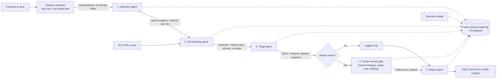

# Jagadish-retail-video-agents

**Summary.** Small stores lose money to theft, till mistakes and safety incidents, but they cannot watch every camera.
This project shows five cooperating agents that turn camera detections and till events into scored, explained
alerts, and a human review gate so that **no one is ever labeled a thief by software**. Everything runs offline
on Python 3.12 with the standard library. Proof: 40 tests passing locally, 11 incident types, and a synthetic demo
day where 15 detector events became 14 incidents, 3 were hidden as duplicates or false alarms, and the audit chain verified.

> Local-only learning project. All data is **synthetic**. No real video, no real people, no real store.
> The demo store "Northbrook Corner Market" is fictional.

## Purpose and who it is for
- Owners of small and mid-size stores who want loss and safety alerts without sending video to the cloud.
- Engineers who want a reference for privacy-first video AI: edge box in the store, video stays local,
  alerts linked to till data, and a person checks every alert.

## Architecture


## How it works
1. **Detector interface.** `Detector.detect(frames)` returns `DetectorEvent` records (camera, zone, time, label,
   confidence, simple attributes). Today a `SyntheticDetector` replays a seeded day. A real model can implement the
   same method later.
2. **Detection agent** maps labels to 11 incident types with fixed thresholds: concealment, sweethearting, unscanned
   item, after-hours intrusion, loitering, crowding/queue, spill, person down, unattended zone, cash drawer, vehicle in a
   restricted area. It rejects any event that carries face, biometric or identity fields, and every clip reference is a
   blurred-person placeholder.
3. **Till-matching agent** joins risky till events (void, refund, no-sale, discount, drawer open) to lane incidents
   within a 60-second window.
4. **Triage agent** suppresses low confidence (< 0.60) and agreed false positives (for example entrance mat glare),
   removes duplicates within 30 seconds, and scores risk = (base risk + 0.15 per linked till event, max +0.30) x
   detector confidence. Every step is written as a reason. Safety incidents always go to review.
5. **Human review gate.** Only a named, authorised manager can confirm theft or clear an alert. Each approval token is
   single-use, scoped to one incident and one decision, and expires (15 minutes by default). Theft labels are only
   allowed on loss types, and a hesitant note ("not sure", "wait") is refused.
6. **Report agent** writes the daily summary, safety items first, and always ends with the no-accusation line.

## Real demo output (synthetic data)
Run: `python3.12 -m retail_agents.pipeline`
```text
detector events: 15  pos events: 24  incidents: 14
  I001 concealment            aisle-5           status=cleared         score=0.546 links=0
  I002 sweethearting          lane-2            status=confirmed_theft score=0.63 links=2
  I003 unscanned_item         lane-3            status=logged          score=0.352 links=0
  I004 unscanned_item         lane-3            status=duplicate       score=0.0 links=0
  I005 after_hours_intrusion  backroom          status=needs_review    score=0.651 links=0
  I006 loitering              entrance          status=logged          score=0.16 links=0
  I007 crowding               lane-1            status=needs_review    score=0.285 links=0
  I008 spill                  aisle-2           status=needs_review    score=0.534 links=0
  I009 person_down            aisle-7           status=needs_review    score=0.828 links=0
  I010 unattended_zone        pharmacy-counter  status=logged          score=0.291 links=0
  I011 cash_drawer            lane-4            status=needs_review    score=0.675 links=2
  I012 restricted_vehicle     fire-lane         status=logged          score=0.348 links=0
  I013 concealment            aisle-5           status=suppressed      score=0.0 links=0
  I014 spill                  entrance          status=suppressed      score=0.0 links=0
gate denials: ['no approval', 'token already used']
Daily summary for Northbrook Corner Market, store 12 (fictional) (synthetic data)
- Incidents found: 14
- Waiting for a manager: 5
- Confirmed theft by a manager: 1
- Cleared by a manager: 1
- Logged only (low risk): 4
- Hidden as duplicates: 1
- Hidden as likely false alarms: 2
Safety first: crowding in lane-1; spill in aisle-2; person_down in aisle-7
Check I009: person_down in aisle-7, score 0.828 (base risk for person_down: 0.90; x0.92 detector confidence)
Check I011: cash_drawer in lane-4, score 0.675 (base risk for cash_drawer: 0.45; +0.30 for 2 linked till event(s); x0.90 detector confidence)
Check I005: after_hours_intrusion in backroom, score 0.651 (base risk for after_hours_intrusion: 0.70; x0.93 detector confidence)
No one is accused by this system. Only a manager can label theft.
clips purged by retention: 1
audit entries: 11  chain valid: True
```

## How to run
```bash
python3.12 -m retail_agents.pipeline          # demo day
python3.12 -m unittest discover -s tests -v   # 40 tests
python3.12 scripts/count_tests.py             # prints TOTAL_TESTS
```
No installs, no network, no cloud.

## Guardrails
| Control | Where | Test |
|---|---|---|
| No face recognition or biometric IDs; identity fields rejected | `guardrails.check_no_biometrics` | yes |
| People shown only as blurred placeholders | `guardrails.blur_placeholder` | yes |
| PII redaction (phone, email, SSN, card) in audit details | `guardrails.redact` | yes |
| Retention limits: unflagged 3 days, reviewed 30, confirmed 90 | `guardrails.RETENTION_DAYS` | yes |
| Hash-chained audit log, tamper and reorder detected | `audit.AuditLog` | yes |
| No auto-accusation; manager gate for theft labels | `agents.ReviewGate` | 14 gate tests |
| Cashiers stored as pseudonymous tokens only | `PosEvent.cashier_ref` | design |

Privacy and legal notes: [docs/privacy-notes.md](docs/privacy-notes.md).

## Limitations
- Detection rules and scores are hand-set constants on synthetic data, not tuned or measured on real video.
- No real model, camera or till integration exists yet. Accuracy, false alarm rate and latency are unknown.
- Dedupe is per zone and type only; one person walking between zones creates separate incidents.
- The hesitant-note check is a short keyword list, not language understanding.
- Clocks are assumed in sync between cameras and tills.

## Built vs planned
| Item | Status |
|---|---|
| Five agents, gate, guardrails, audit, synthetic day, 40 tests | Built |
| Real detector adapter on an edge GPU box | Planned |
| Real till export adapter | Planned |
| Edge box sizing (cameras per box, latency, cost) | Planned, to be measured |
| CI | Not set up (local-only project) |

## Docs
- [Implementation guide](docs/implementation-guide.md)
- [Cheat sheet (simple English)](docs/cheat-sheet.md)
- [Interview points](docs/interview-points.md)
- [Threat model](docs/threat-model.md)
- [Privacy notes](docs/privacy-notes.md)
- [ADRs](docs/adr/)
