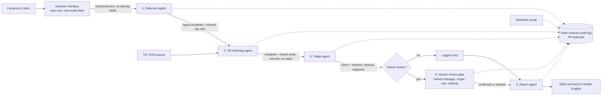
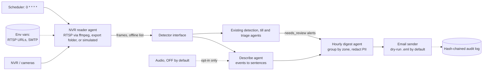

# Jagadish-retail-video-agents

[](https://github.com/jagadishmazure-jpg/Jagadish-retail-video-agents/actions/workflows/ci.yml) [](https://github.com/jagadishmazure-jpg/Jagadish-retail-video-agents/actions/workflows/codeql.yml)  

**Summary.** Small stores lose money to theft, till mistakes and safety incidents, but they cannot watch every camera.
This project shows five cooperating agents that turn camera detections and till events into scored, explained
alerts, and a human review gate so that **no one is ever labeled a thief by software**. Everything runs offline
on Python 3.12 with the standard library. Proof: 90 tests passing, 11 incident types, and a synthetic demo
day where 15 detector events became 14 incidents, 3 were hidden as duplicates or false alarms, and the audit chain verified.

> Learning and portfolio project. Demo data is **synthetic**, except the real-video demo, which runs on openly licensed sample clips. No real video, no real people, no real store.
> The demo store "Northbrook Corner Market" is fictional.

## Purpose and who it is for
- Owners of small and mid-size stores who want loss and safety alerts without sending video to the cloud.
- Engineers who want a reference for privacy-first video AI: edge box in the store, video stays local,
  alerts linked to till data, and a person checks every alert.

## Architecture


## How it works
1. **Detector interface.** `Detector.detect(frames)` returns `DetectorEvent` records (camera, zone, time, label,
   confidence, simple attributes). Today a `SyntheticDetector` replays a seeded day. A real model can implement the
   same method later.
2. **Detection agent** maps labels to 11 incident types with fixed thresholds: concealment, sweethearting, unscanned
   item, after-hours intrusion, loitering, crowding/queue, spill, person down, unattended zone, cash drawer, vehicle in a
   restricted area. It rejects any event that carries face, biometric or identity fields, and every clip reference is a
   blurred-person placeholder.
3. **Till-matching agent** joins risky till events (void, refund, no-sale, discount, drawer open) to lane incidents
   within a 60-second window.
4. **Triage agent** suppresses low confidence (< 0.60) and agreed false positives (for example entrance mat glare),
   removes duplicates within 30 seconds, and scores risk = (base risk + 0.15 per linked till event, max +0.30) x
   detector confidence. Every step is written as a reason. Safety incidents always go to review.
5. **Human review gate.** Only a named, authorised manager can confirm theft or clear an alert. Each approval token is
   single-use, scoped to one incident and one decision, and expires (15 minutes by default). Theft labels are only
   allowed on loss types, and a hesitant note ("not sure", "wait") is refused.
6. **Report agent** writes the daily summary, safety items first, and always ends with the no-accusation line.

## Real demo output (synthetic data)
Run: `python3.12 -m retail_agents.pipeline`
```text
detector events: 15  pos events: 24  incidents: 14
  I001 concealment            aisle-5           status=cleared         score=0.546 links=0
  I002 sweethearting          lane-2            status=confirmed_theft score=0.63 links=2
  I003 unscanned_item         lane-3            status=logged          score=0.352 links=0
  I004 unscanned_item         lane-3            status=duplicate       score=0.0 links=0
  I005 after_hours_intrusion  backroom          status=needs_review    score=0.651 links=0
  I006 loitering              entrance          status=logged          score=0.16 links=0
  I007 crowding               lane-1            status=needs_review    score=0.285 links=0
  I008 spill                  aisle-2           status=needs_review    score=0.534 links=0
  I009 person_down            aisle-7           status=needs_review    score=0.828 links=0
  I010 unattended_zone        pharmacy-counter  status=logged          score=0.291 links=0
  I011 cash_drawer            lane-4            status=needs_review    score=0.675 links=2
  I012 restricted_vehicle     fire-lane         status=logged          score=0.348 links=0
  I013 concealment            aisle-5           status=suppressed      score=0.0 links=0
  I014 spill                  entrance          status=suppressed      score=0.0 links=0
gate denials: ['no approval', 'token already used']
Daily summary for Northbrook Corner Market, store 12 (fictional) (synthetic data)
- Incidents found: 14
- Waiting for a manager: 5
- Confirmed theft by a manager: 1
- Cleared by a manager: 1
- Logged only (low risk): 4
- Hidden as duplicates: 1
- Hidden as likely false alarms: 2
Safety first: crowding in lane-1; spill in aisle-2; person_down in aisle-7
Check I009: person_down in aisle-7, score 0.828 (base risk for person_down: 0.90; x0.92 detector confidence)
Check I011: cash_drawer in lane-4, score 0.675 (base risk for cash_drawer: 0.45; +0.30 for 2 linked till event(s); x0.90 detector confidence)
Check I005: after_hours_intrusion in backroom, score 0.651 (base risk for after_hours_intrusion: 0.70; x0.93 detector confidence)
No one is accused by this system. Only a manager can label theft.
clips purged by retention: 1
audit entries: 11  chain valid: True
```


## NVR-to-text hourly email (restaurant use case)
A second pipeline turns NVR video into plain sentences and emails a digest every hour. The demo site,
"Peachtree Ember Kitchen" in Atlanta, is fictional.



1. **NVR reader agent** (`nvr.py`) reads each camera from its own source. An offline camera is logged and listed in the
   email; the other cameras keep going. A hardcoded URL in config is refused, and credentials are masked in errors.
2. **Describe agent** (`describe.py`) turns detector events into lines like `18:05 back-door: 1 person(s) carried 2 box(es) out`.
   The speech-to-text path refuses unless audio is explicitly enabled.
3. **Hourly digest agent** (`digest.py`) keeps only the last hour, groups it by zone, puts triage alerts first, redacts
   PII, and renders plain text and HTML.
4. **Email sender** (`mailer.py`) is dry-run by default and writes `.eml` files. Live SMTP reads env vars, retries 3 times,
   and logs every attempt. Tests use a fake SMTP class; no real email is ever sent.
5. **Scheduler** (`scheduler.py`, `scripts/hourly_digest.py`) supports a cron loop; cron and systemd examples are in
   [docs/nvr-setup.md](docs/nvr-setup.md).

### Real demo output (synthetic data, simulated cameras)
Run: `python3.12 -m retail_agents.restaurant_demo`
```text
frames sampled: 36  cameras offline: ['cam-patio']
dry-run email written: digest-1800.eml (not sent)
audit entries: 8  chain valid: True
Subject: [Peachtree Ember Kitchen, Atlanta (fictional)] Hourly digest 18:00-19:00: 3 alert(s)
Hourly digest for Peachtree Ember Kitchen, Atlanta (fictional) (synthetic data)
Window: 18:00-19:00

ALERTS (a manager must review; these are not accusations):
  ! 18:25 cash_drawer in lane-1, score 0.682: base risk for cash_drawer: 0.45; +0.30 for 2 linked till event(s); x0.91 detector confidence
  ! 18:35 spill in dining-room, score 0.522: base risk for spill: 0.60; x0.87 detector confidence
  ! 18:45 crowding in lane-1, score 0.279: base risk for crowding: 0.30; x0.93 detector confidence

CAMERAS OFFLINE: cam-patio

back-door (3):
  - 18:05 back-door door opened
  - 18:05 back-door: 1 person(s) carried 2 box(es) out
  - 18:55 back-door door opened
dining-room (2):
  - 18:15 dining-room: 6 guests waiting for a table
  - 18:35 dining-room: liquid on floor
lane-1 (2):
  - 18:25 lane-1: cash drawer open with no customer
  - 18:45 lane-1: queue of 8

No faces are recognised. People are shown blurred. Audio is off unless enabled.
```

### Configure with a real NVR
See [docs/nvr-setup.md](docs/nvr-setup.md) for RTSP and export-folder config, SMTP env vars, cron and systemd timer, and
audio rules.

### Limitations of the NVR pipeline
- Only simulated sources were run. The RTSP path is tested with a fake ffmpeg runner, not a real stream.
- The describer is template-based. It describes detector labels, not the image.
- Frames are sampled but not yet passed to a real detector; the demo replays scripted events for the hour.
- Live SMTP is tested only against a fake server.
- Outbox retention (`purge_outbox`, 30 days by default) must be scheduled by the operator.

## Real-video demo (openly licensed sample clips, measured on this machine)
Four short public sample clips (a store with a cart, a restaurant kitchen, a parking lot, people walking) are
downloaded by `scripts/fetch_samples.py`, checked by SHA-256, re-encoded to MP4 without audio, and dropped into an
NVR-style export folder. Licenses are listed in [data/SAMPLES.md](data/SAMPLES.md). Videos and weights are not committed.

The pipeline then runs for real: export-folder source -> ffmpeg samples 1 frame every 5 s -> an Apache-2.0 nano
object detector (ONNX, CPU only) counts people, vehicles and bags -> the describe and digest agents build the hourly
email -> the mailer writes a dry-run `.eml`. Sampled frames are deleted right after detection. A fifth camera points at
a missing folder to show the offline path.

```bash
pip install -r requirements-detector.txt
python3.12 scripts/fetch_samples.py
python3.12 scripts/real_video_demo.py
```

Measured output (one run; CPU inference speed varied between about 88 and 200 frames/s across three runs on this
shared machine):
```text
MEASURED on this machine: x86_64 python 3.12.14
clips read: 4  cameras offline: ['cam-patio']
frames sampled (1 per 5s): 26 in 0.84s
objects detected (conf>=0.35): 108  detector events: 18
CPU inference: 0.13s total, 200.2 frames/s
incidents: 0  dry-run email: digest-real-1800.eml  audit valid: True
Subject: [Peachtree Ember Kitchen, Atlanta (fictional)] Hourly digest 18:00-19:00: 0 alert(s)
Hourly digest for Peachtree Ember Kitchen, Atlanta (fictional) (openly licensed sample clips, real detections)
Window: 18:00-19:00

CAMERAS OFFLINE: cam-patio

lane-1 (1):
  - 18:00 lane-1: 3 person(s), 1 vehicle(s), 0 bag(s) visible
kitchen (4):
  - 18:10 kitchen: 4 person(s), 0 vehicle(s), 0 bag(s) visible
  - 18:10 kitchen: 1 person(s), 0 vehicle(s), 0 bag(s) visible
  - 18:10 kitchen: 1 person(s), 0 vehicle(s), 0 bag(s) visible
  - 18:10 kitchen: 1 person(s), 0 vehicle(s), 0 bag(s) visible
fire-lane (10):
  - 18:20 fire-lane: 0 person(s), 4 vehicle(s), 0 bag(s) visible
  - 18:20 fire-lane: 0 person(s), 5 vehicle(s), 0 bag(s) visible
  - 18:20 fire-lane: 0 person(s), 2 vehicle(s), 0 bag(s) visible
  - 18:20 fire-lane: 1 person(s), 4 vehicle(s), 0 bag(s) visible
  - 18:20 fire-lane: 0 person(s), 4 vehicle(s), 0 bag(s) visible
  - 18:20 fire-lane: 2 person(s), 4 vehicle(s), 0 bag(s) visible
  - 18:20 fire-lane: 0 person(s), 4 vehicle(s), 0 bag(s) visible
  - 18:20 fire-lane: 0 person(s), 5 vehicle(s), 0 bag(s) visible
  - 18:20 fire-lane: 0 person(s), 4 vehicle(s), 0 bag(s) visible
  - 18:20 fire-lane: 0 person(s), 4 vehicle(s), 0 bag(s) visible
entrance (3):
  - 18:30 entrance: 7 person(s), 0 vehicle(s), 0 bag(s) visible
  - 18:30 entrance: 6 person(s), 0 vehicle(s), 0 bag(s) visible
  - 18:30 entrance: 8 person(s), 0 vehicle(s), 0 bag(s) visible

No faces are recognised. People are shown blurred. Audio is off unless enabled.```
What it shows honestly: counts are real model output, and some are wrong (for example 1 "vehicle" in the store clip).
No incidents fired, because none of the clips contains a loss or safety event, a queue of 7+ in a lane, or a vehicle
stopped for 5+ minutes (each clip is at most 60 s). The stub detector is still the default for tests.

## How to run
```bash
python3.12 -m retail_agents.pipeline          # demo day
python3.12 -m unittest discover -s tests -v   # 90 tests
python3.12 scripts/count_tests.py             # prints TOTAL_TESTS
python3.12 -m retail_agents.restaurant_demo   # hourly digest, dry-run
python3.12 scripts/hourly_digest.py --loop    # cron loop, dry-run
```
No installs, no network, no cloud.

## Guardrails
| Control | Where | Test |
|---|---|---|
| No face recognition or biometric IDs; identity fields rejected | `guardrails.check_no_biometrics` | yes |
| People shown only as blurred placeholders | `guardrails.blur_placeholder` | yes |
| PII redaction (phone, email, SSN, card) in audit details | `guardrails.redact` | yes |
| Retention limits: unflagged 3 days, reviewed 30, confirmed 90 | `guardrails.RETENTION_DAYS` | yes |
| Hash-chained audit log, tamper and reorder detected | `audit.AuditLog` | yes |
| Audio off by default; ffmpeg strips audio; STT refuses unless enabled | `describe.DescribeAgent`, `nvr.RtspSource` | yes |
| No credentials in config; RTSP/SMTP from env; URLs masked in errors | `nvr.CameraConfig`, `mailer.SmtpConfig` | yes |
| Every digest written or sent is audited; dry-run by default | `mailer.EmailSender` | yes |
| Outbox retention | `mailer.purge_outbox` | yes |
| No auto-accusation; manager gate for theft labels | `agents.ReviewGate` | 14 gate tests |
| Cashiers stored as pseudonymous tokens only | `PosEvent.cashier_ref` | design |

Privacy and legal notes: [docs/privacy-notes.md](docs/privacy-notes.md).

## Limitations
- Detection rules and scores are hand-set constants on synthetic data, not tuned or measured on real video.
- No real model, camera or till integration exists yet. Accuracy, false alarm rate and latency are unknown.
- Dedupe is per zone and type only; one person walking between zones creates separate incidents.
- The hesitant-note check is a short keyword list, not language understanding.
- Clocks are assumed in sync between cameras and tills.

## Built vs planned
| Item | Status |
|---|---|
| Five agents, gate, guardrails, audit, synthetic day | Built |
| NVR-to-text hourly email pipeline (reader, describer, digest, dry-run mailer, scheduler) | Built, simulated sources only |
| 90 tests | Built |
| Live RTSP capture and live SMTP send | Written, not run against real hardware or mail server |
| Local vision-language describer and speech-to-text engine | Planned (stub interfaces now) |
| Optional real detector backend (ONNX, CPU) on sample clips | Built, measured on this machine |
| Real detector on an edge GPU box with live cameras | Planned |
| Real till export adapter | Planned |
| Edge box sizing (cameras per box, latency, cost) | Planned, to be measured |
| CI (ruff + tests + demos), CodeQL, Dependabot | Built |

## Docs
- [Implementation guide](docs/implementation-guide.md)
- [Cheat sheet (simple English)](docs/cheat-sheet.md)
- [Interview points](docs/interview-points.md)
- [Threat model](docs/threat-model.md)
- [Privacy notes](docs/privacy-notes.md)
- [NVR setup and scheduling](docs/nvr-setup.md)
- [ADRs](docs/adr/)
