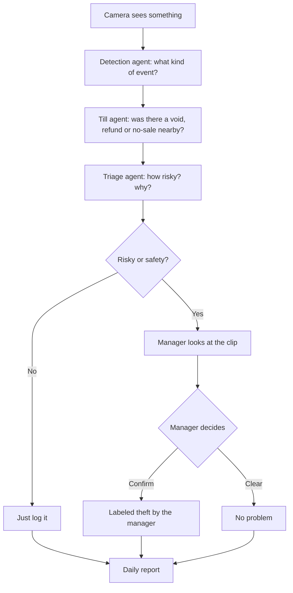
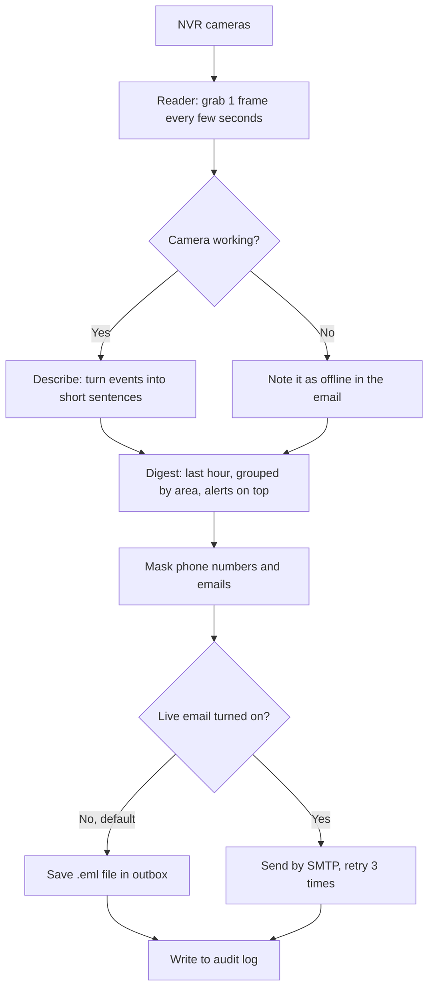

# Cheat sheet: retail video agents in simple English

## 10 things to remember
1. Video stays inside the store on a small box. Nothing goes to the cloud.
2. The system never knows who a person is. No faces, no biometrics.
3. People always show as blurred shapes.
4. 11 alert types: hiding items, cashier passing items free, unscanned items, after-hours entry, loitering, long queues, spills, person down, empty counter, cash drawer, parked vehicle in a fire lane.
5. Till events (void, refund, no-sale, discount, drawer open) make an alert stronger when they happen at the same lane within 60 seconds.
6. Every score comes with reasons a manager can read.
7. Weak, repeated or known false alerts are hidden automatically.
8. Only a named manager can call something theft. The approval works once, for one alert, and expires.
9. Every action is written to a tamper-proof log with personal details masked.
10. Clips are deleted on a schedule: 3, 30 or 90 days.

## One-line interview answer
"I built an edge video AI pipeline where five agents detect, link till data, score with reasons, and report, but only a named manager can confirm theft, with no face recognition and a tamper-proof audit trail."

---

# Cheat sheet: NVR to text, hourly email

## 10 things to remember
1. The reader takes one picture every N seconds from each camera, not full video.
2. It can read a live stream, a folder of exported clips, or fake data for tests.
3. Camera passwords live in environment variables, never in code or config.
4. If one camera is down, the email says so and the rest keep working.
5. The describer writes plain lines like "18:05 back door opened".
6. Microphones stay off. Audio needs a deliberate switch and a legal check.
7. Every hour, the digest groups lines by area and puts alerts first.
8. Alerts are things to check, not accusations.
9. Email is dry-run by default: it saves a file and sends nothing.
10. Every digest is written to the tamper-proof audit log.

## One-line interview answer
"I turned NVR video into an hourly text email: a pluggable reader, a describer, a digest with alerts on top, and a dry-run-first SMTP sender with retries, all audited and with mics off by default."
