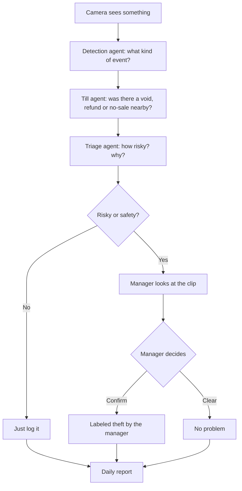

# Cheat sheet: retail video agents in simple English

## 10 things to remember
1. Video stays inside the store on a small box. Nothing goes to the cloud.
2. The system never knows who a person is. No faces, no biometrics.
3. People always show as blurred shapes.
4. 11 alert types: hiding items, cashier passing items free, unscanned items, after-hours entry, loitering, long queues, spills, person down, empty counter, cash drawer, parked vehicle in a fire lane.
5. Till events (void, refund, no-sale, discount, drawer open) make an alert stronger when they happen at the same lane within 60 seconds.
6. Every score comes with reasons a manager can read.
7. Weak, repeated or known false alerts are hidden automatically.
8. Only a named manager can call something theft. The approval works once, for one alert, and expires.
9. Every action is written to a tamper-proof log with personal details masked.
10. Clips are deleted on a schedule: 3, 30 or 90 days.

## One-line interview answer
"I built an edge video AI pipeline where five agents detect, link till data, score with reasons, and report, but only a named manager can confirm theft, with no face recognition and a tamper-proof audit trail."
